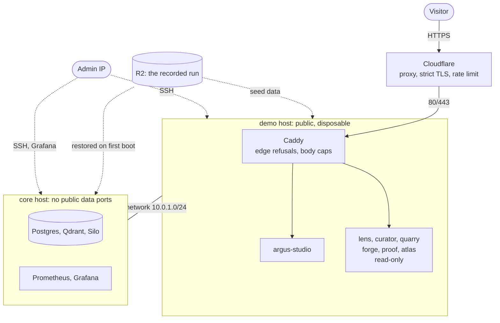

# argus-halo

[](https://github.com/smk762/argus-halo/actions/workflows/terraform.yml)
[](LICENSE)

Terraform for a public, read-only deployment of the [Argus](https://dragonhound.dev) ML-tooling suite: two Hetzner hosts split public/private, behind Cloudflare, with state in HCP Terraform. About €11 a month.

> **Project page:** [halo.dragonhound.dev](https://halo.dragonhound.dev). **Status:** the stack is not currently running. The public demos on [dragonhound.dev](https://dragonhound.dev) are static; this repository is the full-stack deployment. It is validated in CI by mocked-provider plans and by booting the demo tier from its pinned images.



## What to look at

| If you care about | See |
|---|---|
| Catching a bad plan before it half-applies | [preflight.tf](preflight.tf): a postcondition checks the server type against live Hetzner stock and lists what is available instead |
| Testing infrastructure without credentials | [tests/security.tftest.hcl](tests/security.tftest.hcl): `terraform test` plans against mocked providers and asserts firewall, TLS, DNS and rate-limit properties |
| Dangerous inputs | [variables.tf](variables.tf): `admin_ip = 0.0.0.0/0` fails validation |
| Not replacing hosts to bump a version | [stack/](stack/): `user_data` carries only config and a fetcher, because it is ForceNew. Service definitions update in place |
| Guarding the one irreplaceable thing | [dns.tf](dns.tf): `prevent_destroy` on the R2 bucket, so `terraform destroy` refuses |
| Cross-file invariants `validate` cannot see | [scripts/check-cloud-init.sh](scripts/check-cloud-init.sh): renders templates, then checks routes, WAF, environment, pins and read-only posture agree |
| Proving a public attack surface | [scripts/smoke-demo.py](scripts/smoke-demo.py): boots the demo tier from its real pins and probes what it refuses |

## Layout

```
*.tf                 root: network, the two hosts, DNS/TLS, WAF, preflight
modules/{core,demo}  one server and firewall each, plus its cloud-init
modules/stock        which server types can be built in a location right now
stack/{core,demo}    compose files, Caddyfile and restore scripts the hosts fetch
tests/               terraform test, against mocked providers
scripts/             config checker, smoke test, tape builder
web/                 static project page (halo.dragonhound.dev)
docs/                decisions, security, environment, tape, monitoring, runbook
```

## Quick start

Check it without any account:

```bash
make validate   # templates, routes, pins, fmt, validate
make test       # terraform test, mocked providers
make smoke      # boot the demo tier in Docker and probe it (about 14 GB of images)
```

Deploy it:

```bash
terraform login                                # HCP Terraform; set your org in versions.tf
cp terraform.tfvars.example terraform.tfvars   # or use workspace variables
terraform init
terraform plan
terraform apply
```

`terraform destroy -target=module.demo` tears down the public half and leaves the stores up. The [runbook](docs/runbook.md) covers the full lifecycle: pre-deploy gates, verification, in-place updates, secret rotation, teardown and troubleshooting.

## Decisions

Each is argued in [docs/decisions.md](docs/decisions.md).

- **Two hosts, for blast radius.** Everything fits on one. The split keeps a compromise of the public tier away from the database.
- **No GPU.** GPU work ran once on local hardware and was recorded. The demo replays that output.
- **Silo for object storage.** Upstream MinIO stopped publishing images and archived its repository; [Silo](https://github.com/pgsty/silo) is the maintained fork.
- **No block volume.** The data is a reproducible build artifact, so durability lives in R2.
- **Service definitions are fetched, not baked into `user_data`.** A version bump is a merge and an in-place update; volumes, certificates and the IP survive. The trade is that advancing `main` is the deploy channel.

## Security

[docs/security.md](docs/security.md) lists every control and the test that checks it. The short version: the proxy is a passthrough, so each service's own gating is the boundary, and the smoke test re-proves that gating on every pull request that could move a pin.

## More

- [Environment](docs/environment.md): every key, where it comes from, who receives it
- [The tape](docs/tape.md): how the recorded run is built, stored and restored
- [Monitoring](docs/monitoring.md): Prometheus and Grafana on core

## Known gaps

- **Strict TLS is zone-wide.** `cloudflare_zone_setting.ssl` applies to every proxied origin in the zone. Check that each one holds a valid certificate before the first apply, or it starts returning 526.
- **Nothing reads the core stores yet.** They are provisioned and seeded ahead of lens's lineage-replay backend ([argus-lens#45](https://github.com/smk762/argus-lens/issues/45)). Until then lens captions through a hosted endpoint.
- **The tape is not published** ([#9](https://github.com/smk762/argus-halo/issues/9)), so a fresh deploy starts with empty galleries. `/atlas` needs a seeded job, and quarry's Sources view needs a ~45 GB archive this host does not mount.
- **Remote `plan` in CI** is wired but skipped until a `TF_API_TOKEN` secret is set.

## Branches

`dev` is the default branch and the base for every PR. Cut feature branches from `origin/dev` and update them by merging `origin/dev`, never `main`. Never open a PR against `main`. A release fast-forwards `main` to a `dev` commit that passed CI (`git push origin origin/dev:main`); hosts track `main`, and there are no version tags.

## License

MIT. See [LICENSE](LICENSE).

*Halation: the bloom of light around a bright point on film, the halo the lens can't help but throw.*
